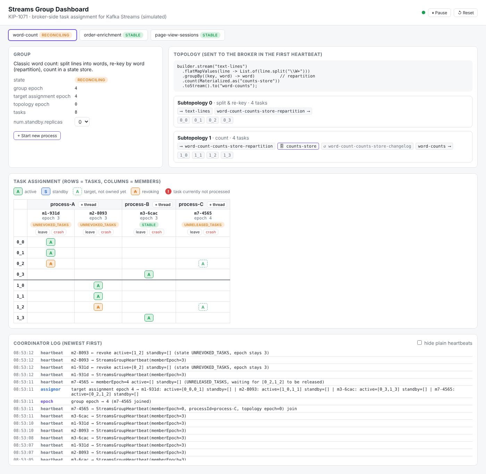

# Streams Console (KIP-1071)

觀察 Kafka Streams 應用程式的維運 console，對應 Kafka 4.1 的 **streams rebalance protocol**（KIP-1071，`group.protocol=streams`）：broker 端的 group coordinator 負責分配 task，console 從 broker 讀出每個 streams group 的 pipeline、task 分配、資料流量與設定。

**Console 只讀**：它連到 broker、自動發現所有 streams group，不啟動、不停止、也不 host 任何應用程式。唯一的寫入是 broker 端的 standby group config。示範用的應用程式和資料是另外的 docker compose 服務。



## 跑起來

```bash
docker compose up -d --build   # broker + setup（topic、group config）+ producer + 三個示範 app
bun install
bun run build:java             # console 用的 inspector（Java，包 Admin API）
bun run dev                    # 打開 http://localhost:5173
```

## 操作示範 app（用 Docker，不是 console）

| 想看什麼 | 指令 |
| --- | --- |
| 擴充成 2 個實例，task 重新分配 | `docker compose up -d --scale word-count=2` |
| 一個實例 2 個 StreamThread（2 個 member、同一個 process） | `WORD_COUNT_THREADS=2 docker compose up -d word-count` |
| 模擬 crash：先變 **stalled**，session timeout 後 **fenced** | `docker kill kafka-streams-group-dashboard-word-count-2` |
| 正常關閉：立刻 **left** | `docker stop kafka-streams-group-dashboard-word-count-2` |

`docker compose kill` 會殺掉同一個 service 的所有實例，要殺單一實例請用 `docker kill <container>`。

## Console 看得到什麼

| 區塊 | 內容 |
| --- | --- |
| 側欄 | 所有 streams group（從 broker 發現），有 stalled / fenced 的排最前面；EN / 繁中、系統 / 淺色 / 深色 |
| 總覽 | group 數、process 數、總輸入速率、最大 lag；每個 stalled 或剛被 fence 的 process 一則警示 |
| Pipeline | subtopology 為節點、topic 為連線，線上是 rec/s，節點上是 lag；點節點打開右側抽屜 |
| Task 分配 / Process / 設定 / 記錄 | task × member 矩陣、process 卡片（含 60 秒內被 fence 的灰色卡片）、group config、coordinator 記錄 |

**Stalled / fenced 從哪來**：broker 不回報心跳，所以 console 用 committed offset 判斷進度。input 持續進來、某 task 的 committed offset 卻超過門檻（觀察到的 commit 間隔 × 3，至少 5 秒）沒動，就是 stalled；task 換 owner 時重新計時。member 消失前是 stalled 就記為 fenced，否則是 left。Console 不說「crashed」：它分不出 crash、網路斷線或長 GC。

**Broker 不知道的**：sink topic、processor 名稱和 DSL 不在 client 送給 broker 的 topology 裡，所以 pipeline 畫到最後一個 subtopology 為止。

## 開發流程

規格與驗收在 [`docs/specs/`](docs/specs/)，流程在 [`docs/process/workflow.md`](docs/process/workflow.md)。

| 指令 | 用途 |
| --- | --- |
| `bun run check` | 單元測試 + build + traceability + test-plan（本機 gate） |
| `bun run test:e2e` | 對 compose demo 跑 E2E（會 build image、scale、kill、stop、重啟 broker） |

## 結構

```
docker-compose.yml       broker、setup、producer、word-count / order-enrichment / page-view-sessions
streams-app/             Java：run（示範 app）、produce、setup、inspect（console 用，Admin API → JSON）
server/real/             console backend：輪詢 inspector、rate / lag、stalled / fenced、事件
shared/                  前後端共用型別與 pipeline 版面
src/                     Vue 3 前端（Streams Console design system）
e2e/                     對真 broker + compose demo 的 E2E
```
